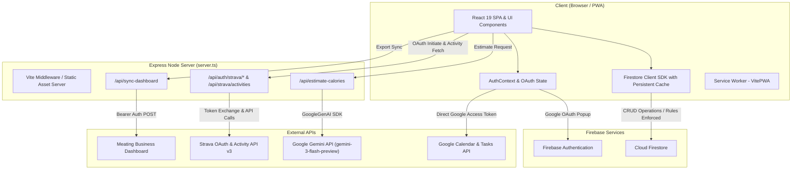

# Architecture Specification

## 1. System Overview

Meating is a hybrid full-stack application consisting of:
1. **Client**: A React 19 Single Page Application (SPA) built with TypeScript, Tailwind CSS v4, and bundled as a Progressive Web App (PWA).
2. **Server**: An Express 4 server (`server.ts`) that runs Vite in middleware mode during development and serves static build assets + `/api/*` proxy endpoints in production.
3. **Backend Services (Current)**: Firebase Auth for Google OAuth, Cloud Firestore for persistent document storage, Google GenAI SDK for AI calorie estimation, Google Workspace APIs for Calendar/Tasks, and Strava OAuth API v3 for activity synchronization.



---

## 2. Request Lifecycle

### A. Page Load & Initialization
1. Browser requests `/`.
2. Service Worker (`vite-plugin-pwa`) checks cache; if online or uncached, fetches `index.html` from Express server.
3. React mounts at root element in `src/main.tsx`.
4. `AuthProvider` in `src/contexts/AuthContext.tsx` initializes `onAuthStateChanged` listener.
5. If user is authenticated:
   - Queries `users/{uid}` in Firestore.
   - If profile exists, sets `profile` state; if not, writes default profile document.
   - Child route (e.g., `Dashboard`, `Health`) loads user data from Firestore with local caching (`persistentLocalCache`).
6. If unauthenticated, `ProtectedRoute` in `src/App.tsx` redirects user to `/login`.

### B. User Login Flow
1. User clicks "Sign in with Google" on `/login`.
2. `signIn()` in `AuthContext.tsx` initiates `signInWithPopup(auth, provider)` requesting scopes:
   - `https://www.googleapis.com/auth/calendar`
   - `https://www.googleapis.com/auth/tasks`
3. Firebase Auth handles Google OAuth consent dialog.
4. User validates identity.
5. Client verifies `result.user.email === 'l4leather@gmail.com'`. If mismatch, triggers `signOut` and displays access error.
6. Client extracts OAuth access token via `GoogleAuthProvider.credentialFromResult(result)` and stores in `googleAccessToken` state for Calendar/Tasks API calls.

### C. Typical CRUD Action (e.g. Logging Health / Habits)
1. User adds a meal, supplement, or checks off a habit in `Health.tsx` / `Habits.tsx`.
2. Component constructs updated payload with `updatedAt: new Date().toISOString()`.
3. Calls Firestore client SDK (`setDoc`, `addDoc`, or `updateDoc`) at `users/{uid}/healthLogs/{dateStr}`.
4. Firestore updates indexed local cache immediately (optimistic UI update) and syncs to Cloud Firestore.
5. If XP is awarded, `awardXP` in `src/utils/leveling.ts` increments `pilotWins` or `avatarWins` on `users/{uid}`.

### D. Gemini AI Request Flow (Calorie Estimation)
1. User types food item (e.g., "Grilled Salmon 200g with Asparagus") in `Health.tsx` and clicks "AI Estimate".
2. Browser sends `POST /api/estimate-calories` with body `{ mealName: string }`.
3. Express server (`server.ts`) receives request and calls `ai.models.generateContent` via `@google/genai` SDK using `process.env.GEMINI_API_KEY`.
4. Model (`gemini-3-flash-preview`) produces structured JSON matching schema `{ calories: number, notes: string }`.
5. Server sends JSON response back to client.
6. UI populates meal calorie input and appends nutritionist notes.

---

## 3. PWA (Progressive Web App) Architecture

- **Plugin**: `vite-plugin-pwa` v1.2.0 configured in `vite.config.ts`.
- **Register Type**: `registerType: 'autoUpdate'`.
- **Manifest Configuration**:
  - Name: `Meating`
  - Short Name: `Meating`
  - Description: `Pilot your Meat Suit with intention.`
  - Theme Color: `#050505`
  - Background Color: `#050505`
  - Display: `standalone`
  - Icons: `/public/icon.svg` (SVG 192x192 / 512x512)
- **Offline Strategy**:
  - Assets cached via VitePWA Workbox auto-update.
  - Firestore utilizes `persistentLocalCache` with `persistentMultipleTabManager` enabling full offline read/write and background replication when connection resumes.

---

## 4. Security & Environment Architecture

### Security Rules Location
- Firestore security rules are maintained in `firestore.rules`.
- Every document read/write is guarded with `isOwner(userId)` matching `request.auth.uid == userId`.
- Explicit schema validation rules enforce data types, string length caps, and required keys across all collections.

### Storage Buckets
- Legacy bucket `youtube-updater-483515.firebasestorage.app` declared in `firebase-applet-config.json`.
- *Note*: Currently, wishlist image URLs in `Money.tsx` accept direct HTTP URLs. No custom binary assets are actively uploaded to Firebase Storage.

### Environment Variable Matrix

| Variable Name | Scope | Purpose |
|---|---|---|
| `GEMINI_API_KEY` | Server (Express) | API Key for `@google/genai` SDK to invoke Gemini models |
| `APP_URL` | Server (Express) | Canonical base URL used to construct Strava OAuth callback URL |
| `STRAVA_CLIENT_ID` | Server (Express) | Strava API application Client ID |
| `STRAVA_CLIENT_SECRET` | Server (Express) | Strava API application Client Secret |
| `MEATING_DASHBOARD_API_KEY` | Server (Express) | Bearer secret for `/api/sync-dashboard` proxy calls |
| `FIREBASE_PROJECT_ID` | Server / Build | (Optional) Override for Firebase Admin SDK project ID |
| `DISABLE_HMR` | Build/Dev | Platform flag to disable Vite file watching during agent runs |

---

## 5. Build and Deployment Packaging

- **Build Command**:
  ```bash
  vite build && esbuild server.ts --bundle --platform=node --format=esm --packages=external --outfile=dist/server.js
  ```
- **Output**:
  - `dist/index.html` + `dist/assets/*` (Static client bundle)
  - `dist/server.js` (Bundled Node.js ESM server)
- **Production Execution**:
  ```bash
  node dist/server.js
  ```
- **Port Ingress**: Listens on `0.0.0.0:3000`.
